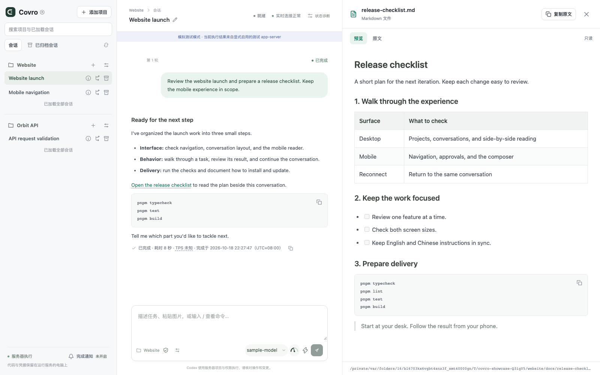
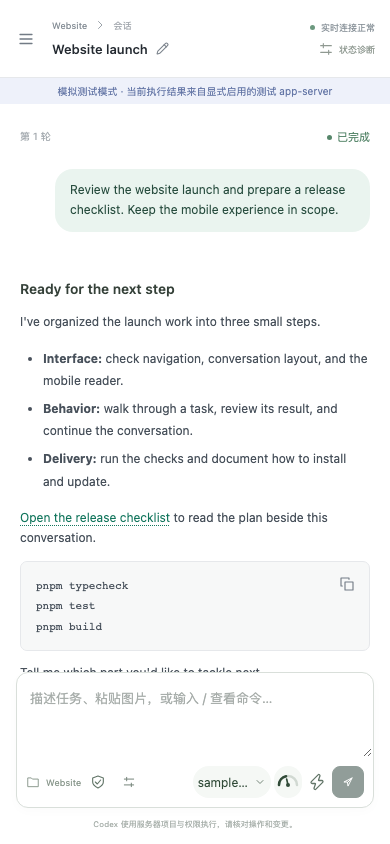

<p align="center">
  <picture>
    <source media="(prefers-color-scheme: dark)" srcset="docs/assets/covro-logo-dark.svg" />
    
  </picture>
</p>

<h1 align="center">在浏览器里，用你的 Codex CLI。</h1>

<p align="center">
  <strong>Covro 是 Codex CLI 的自部署 Web UI。</strong><br />
  在桌前发起任务，用手机查看改动、处理审批，接着推进下一步。
</p>

<p align="center"><strong>自行部署 · 电脑与手机 · 沿用 Codex 登录 · MIT 开源</strong></p>

<p align="center">
  <a href="#开始使用">🚀 开始使用</a> ·
  <a href="#你可以做什么">✨ 功能介绍</a> ·
  <a href="#从其他设备访问">🌐 远程访问</a> ·
  <a href="README.md">English</a>
</p>



<p align="center"><sub>截图来自实际运行的应用，使用示例项目与测试夹具生成的会话。</sub></p>

<a id="你可以做什么"></a>

## ✨ 你可以做什么

- 📱 **离开电脑，也能跟进任务。** 在电脑或手机上查看工具活动与文件变更、处理权限审批、回答 Codex 的问题。关闭页面，任务仍会继续。
- 💬 **无需项目，也能直接开始。** 点击 **新建会话**，应用自动分配独立目录；刷新、重启或归档后，会话和文件仍保留。
- 🌐 **选择界面语言。** 支持简体中文、English、日本語和 한국어，会话内即可切换；输入、回复、工具原文和路径保持不变。[多语言说明](docs/i18n.md)。
- 🗂️ **多个项目，一眼掌握进展。** 让独立任务并行执行，随时看到哪些会话正在工作、等待审批，哪些已有结果可读。
- 💬 **接着你的 Codex CLI 会话。** 浏览已有历史、恢复工作，或 Fork 一个新方向；为会话命名以便查找，完成后归档。在会话详情或状态诊断中查看、复制完整 Thread ID。
- ⚡ **更快打开长会话。** 优先显示最近消息，向上滚动时提前加载历史；本机会话列表和历史分片可先显示缓存，再由服务端核对更新。[加载与缓存说明](docs/session-history.md)。
- 📖 **一边看产出，一边继续讨论。** 电脑上将 Markdown 文档、JSON 文件与会话并排打开，继续向 Codex 提问；Markdown 支持代码、表格、图片和 Mermaid 图表，回复也可直接显示图表，可查看或复制图表源码，并以实际大小查看宽图。JSON 支持格式化缩进、语法高亮，格式无效时保留原文，可复制完整原文，手机上也有全屏阅读器。文件预览保持只读，Markdown 和 JSON 文件限制为 2 MiB。
- 🔎 **逐行查看代码变更。** 在同一只读预览窗口查看某轮或某工具的 Codex 补丁快照，按顺序连续浏览全部文件，支持行号、行内文字高亮和区块跳转；长 diff 默认折叠，展开后按需渲染，阅读时文件标题栏吸顶，随时收起当前文件。
- ✍️ **切换任务，草稿还在。** 每个会话分别保留当前页面中的草稿、粘贴图片和模型设置；完成后可以复制或导出结果。
- 🖥️ **在任务旁运行命令。** 打开 **Shell**，在所选项目目录执行命令、查看实时标准输出和错误输出、中断执行，并复用近期命令。面板沿用 Codex 配置的沙箱，最长运行十分钟，不支持交互输入；关闭面板后命令仍继续运行。[能力与限制](docs/shell.md)。

Mermaid 图表在代码块闭合后于本地渲染，自动适配浅色/深色。渲染失败时保留源码；渲染上限为 50,000 个源码字符、500 条边。

<details>
  <summary><strong>📱 手机上也能舒服地使用</strong></summary>
  <p>查看结果、回答问题、补充下一步要求，不必每次都回到电脑前。</p>
  
</details>

<a id="开始使用"></a>

## 🚀 开始使用

需要 **Node.js 24.x，版本不低于 24.19**，以及已经安装、登录的 **Codex CLI**。界面支持简体中文、英语、日语和韩语。在侧栏选择「语言」；首次访问按浏览器偏好匹配，手动选择会保存在当前设备。

<!-- codex-compatibility:start -->

推荐 Codex CLI：**0.163.0**。已验证版本：`0.163.0`。

<!-- codex-compatibility:end -->

<a id="npm-安装"></a>

### 📦 npm 安装

首个公开 npm 版本正在准备中。`@covro/covro` 发布前，请先[从源码运行](#从源码运行)；发布后，只需安装并启动：

```sh
npm install -g @covro/covro
covro
```

`covro` 默认在后台启动，并输出本机访问地址。打开 **<http://127.0.0.1:8787>** 即可开始使用。关掉终端后，仍可继续通过浏览器工作。

| 命令                      | 用途                                         |
| ------------------------- | -------------------------------------------- |
| `covro status`            | 查看运行实例与访问地址                       |
| `covro doctor`            | 诊断运行实例的会话和 GitHub 凭证，不输出令牌 |
| `covro logs`              | 查看最近的服务日志                           |
| `covro stop`              | 停止服务                                     |
| `covro run`               | 在前台运行                                   |
| `covro service install`   | 在 macOS 或 Linux 上主动启用登录自启         |
| `covro service uninstall` | 移除登录自启                                 |

npm 包名为 `@covro/covro`，命令为 `covro`。开发渠道使用 `npm install -g @covro/covro@dev` 安装。

npm CLI 默认使用 `~/.covro/config.json`，数据目录固定在配置文件旁。可以通过 `covro --config /absolute/path/config.json` 沿用已有配置。

在**服务配置 → 高级设置**中，以 MiB 编辑大小限制（1 MiB = 1024 × 1024 字节）。小数必须精确对应整数字节；已有字节值会原样保留。JSON 文件和 API 继续使用字节，保存后需重启服务生效。

macOS 后台启动使用已登录用户的 GUI launchd 域，使权限允许的命令能够访问已有钥匙串凭证；这不会开启登录自启，登录自启仍需显式运行 `covro service install`。没有桌面会话时仍支持 headless 启动，并提示钥匙串访问限制。安装此修复后，已有实例需要执行 `covro stop` 和 `covro start` 重启。详见[启动与凭证诊断](docs/distribution.md#macos-sessions-and-credentials)。

<a id="从源码运行"></a>

### 🛠️ 从源码运行

想在 npm 发布前体验，或参与开发，可以使用 **pnpm 12.11.2** 从源码运行：

```sh
git clone https://github.com/yuzheng14/codex-web-ui.git covro
cd covro
pnpm install --frozen-lockfile
cp config.example.json config.local.json
pnpm build
pnpm start -- --config ./config.local.json
```

打开 **<http://127.0.0.1:8787>**，点击侧栏 **未关联项目** 标题右侧的 **＋** 即可直接发送任务，无需选择项目。

如需操作项目目录，点击 **添加项目**，选择已有目录，或选择 **克隆 Git 仓库**，填写 HTTPS/SSH 仓库地址、主机上的绝对目标目录和可选项目名称。服务需要能找到 Git，并使用主机已有的认证。弹窗可查看进度、取消克隆；导入完成后打开项目并发送第一条任务。[克隆要求与失败恢复](docs/project-clone.md)。

未关联项目的会话在首次发送时分配 `<dataDir>/workspaces/` 下的独立目录。文件持续保留，归档不会删除文件；目录、恢复与备份规则见[会话工作目录](docs/workspaces.md)。

本地开发可以改用 `pnpm dev`，打开 <http://127.0.0.1:5173>。

<a id="从其他设备访问"></a>

## 🌐 从其他设备访问

Covro 运行在你的电脑上，浏览器是操作入口。关闭页面不会取消任务；重新打开后会连接到服务。运行服务的电脑需要保持唤醒并在线。

| 使用方式                      | 连接方法                                                 |
| ----------------------------- | -------------------------------------------------------- |
| 在运行服务的电脑上            | 打开本机地址                                             |
| 通过 Tailscale 访问自己的设备 | 配置 Tailscale Serve，并将 HTTPS 地址加入 `publicOrigin` |
| 通过 Cloudflare 访问          | 使用 Tunnel、Cloudflare Access 及 Covro 的 JWT 校验      |

完整配置见[部署指南](docs/deployment.md)。新安装默认只监听回环地址，远程访问需单独配置。在手机上添加项目时，填写的仍是运行服务的电脑上的目录。

## 更新与版本渠道

点击侧栏的 **Covro**，可以检查版本、选择渠道、启用空闲时自动升级，或一键升级并重启。CLI 使用同一个升级引擎：

```sh
covro update status
covro update
covro update --channel dev
```

| 渠道   | npm 标签 | 适合                                               |
| ------ | -------- | -------------------------------------------------- |
| 稳定版 | `latest` | 日常使用                                           |
| 预览版 | `beta`   | 维护者通过 Beta 标签或 GitHub Release 选定的预览版 |
| 开发版 | `dev`    | CI 通过后的 main 分支新功能                        |

开发版 npm 发布成功后，还会创建带 GitHub 自动生成说明的 [GitHub Pre-release](https://github.com/yuzheng14/covro/releases)。比较起点取上一个 Dev 版本与稳定版本中源码提交较新的那个；稳定版仍保留原来的分组 Changelog。

每个发行版声明推荐和已验证的 Codex CLI 版本，更新面板会同时显示当前与目标组合。自动升级只接受已验证组合；未验证组合需要对确切目标明确确认。版本未知、声明缺失/无效或明确不支持的组合会阻止受管升级。CLI 可通过 `covro update --allow-unverified-codex` 明确尝试同一组合。Covro 不会自动升级你的 Codex CLI。

自动安装默认关闭。受管升级支持 **macOS 和 Linux 的 npm 全局安装**；源码、链接、容器和 Windows 安装沿用原更新方式。候选版本失败时，会在重新开放业务写入前回滚；降级需通过数据库兼容检查。旧备份会保留，暂不自动轮转。

详细说明见[分发与恢复](docs/distribution.md)、[发版操作](docs/releases.md)。

## 你的电脑，你的工作台

Covro 是面向单用户的 Codex CLI Web UI，通过 `codex app-server` 连接已有 CLI，沿用你的 Codex 登录与配置，在运行服务的电脑上执行任务。项目与 Codex 历史留在那里；Covro 使用 SQLite 保存自身的项目注册和操作记录。它不提供单独的托管账号，也不会把 Codex 登录信息复制到浏览器。Codex 本身仍会访问你配置的模型提供方。

浏览器用于跟进工作、处理请求和继续对话。交互终端、文件编辑器、Git 图形界面与多人团队管理不在当前范围内。

## 开发与参与

```sh
pnpm format:check
pnpm typecheck
pnpm lint
pnpm test
pnpm build
pnpm test:e2e
```

浏览器测试需要现有 Playwright 依赖所对应的 Chromium。测试与 CI 使用明确的测试夹具，不发起真实模型请求。

CI 要求通过 Prettier 格式检查。可在本地运行 `pnpm format` 修复格式，生成文件的排除范围见[格式检查约定](docs/contributing.md#格式检查)。

PR 标题须符合 Conventional Commits，例如 `feat(ui): add JSON preview` 或 `fix: preserve scroll position`。支持的 type、Release PR 检查及 squash 合并与发版约定见[开发与 PR 约定](docs/contributing.md)。

遇到问题或有想法，欢迎[提交 Issue](https://github.com/yuzheng14/codex-web-ui/issues)，附上操作系统、Node.js 与 Codex 版本、安装方式和复现步骤。也欢迎范围明确的小 PR。修改面向使用者的事实或安装步骤时，请同步更新 `README.md` 和 `README.zh-CN.md`。

<a id="文档导航"></a>

## 📚 文档导航

| 指南                                 | 内容                                 |
| ------------------------------------ | ------------------------------------ |
| [详细使用指南](docs/usage.zh-CN.md)  | 项目、会话、审批、通知、图片和恢复   |
| [部署](docs/deployment.md)           | 本机、Tailscale 与 Cloudflare Access |
| [分发](docs/distribution.md)         | CLI、服务、数据位置、升级与修复      |
| [兼容性](docs/compatibility.md)      | 已验证的 Codex 版本与行为边界        |
| [Slash 命令](docs/slash-commands.md) | 支持的命令和用法                     |
| [架构](docs/architecture.md)         | 网关、Codex 适配器与浏览器的协作方式 |
| [验证记录](docs/verification.md)     | 测试范围与真实环境检查记录           |
| [品牌素材](docs/brand.md)            | 可编辑的 SVG 图标与完整标识          |

## 许可证

[MIT](LICENSE)。Covro 是独立项目，与 OpenAI 无隶属关系。
