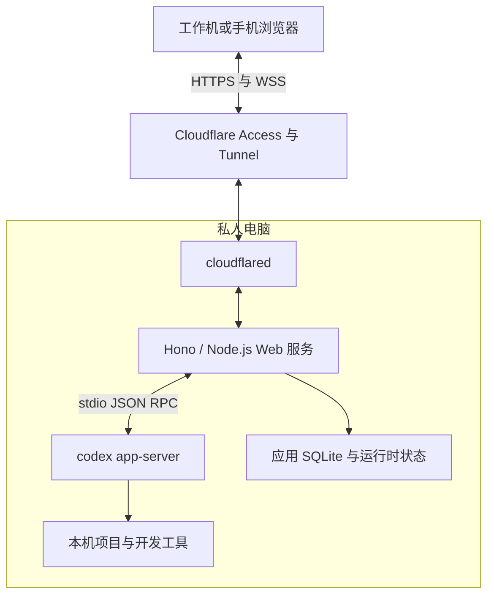

# Codex Web UI 第一版实施规范

版本：1.2  
日期：2026-10-13  
交付目标：实现可在私人电脑上运行的 Codex Web UI，供工作机或手机通过 Cloudflare Tunnel 访问。

## 0. 给开发 Codex 的执行指令

请按照本规范在当前仓库中实现可运行的第一版，完成代码、测试、构建、示例配置和部署说明。

先检查当前仓库、适用的 AGENTS.md、已有代码和运行环境。有现有工程时沿用合理约定；空仓库时按本文初始化。说明简短实施顺序后直接开始开发，持续推进到完成定义，不要只输出方案、页面原型或待办清单。

本文已经确定产品范围和默认技术方案。常规实现细节由你决定，无需逐项询问。遇到与目标 Codex 版本不兼容的接口，先查看该版本生成的协议、帮助和官方文档，修正适配层并记录差异。禁止臆造上游方法、参数或事件来凑齐功能。

本次授权覆盖当前 Web UI 项目内的代码、依赖、测试、构建和说明文件，包括按需修改已有工程。系统级部署与账户操作按第 17 节处理；不要将它扩展为修改用户的全局 Codex 配置，或为演示而修改其他已有业务仓库。

交付时报告实际做了什么、运行了哪些验证、还缺哪些目标机验证。运行环境没有真实 Codex 或登录状态时，完成可独立运行的模拟测试和应用实现，把真实链路明确标为待验证；不要把模拟成功写成真实接入成功。

## 1. 产品目标与默认前提

用户在私人电脑上使用 Codex CLI，希望在工作机打开网页，选择私人电脑上的项目，发送任务、查看执行过程、处理审批、追加要求和中断任务。代码、Git、构建、测试与 Codex 凭据由私人电脑上的进程使用。

第一版按以下前提实现：

- 单人自用，一台私人电脑，一个常驻 Web 服务，一个受管 app-server 进程。
- 私人电脑以 macOS 为主要部署目标；应用保持普通 Node.js 服务形态。
- 可以注册多个项目目录。不同工作区可以分别执行任务。
- Codex CLI 已在目标机安装，并可使用现有登录方式工作。
- 前端、API 和 WebSocket 使用同一个域名。
- 本机开发不需要 Cloudflare；对外访问使用固定 Tunnel 和 Cloudflare Access。
- 私人电脑须处于可工作的运行状态；应用负责显示连接与运行状态，不实现远程开机或唤醒。

核心验收链路：在工作机打开域名，进入私人电脑上的项目，发送任务，看到真实执行过程，关闭页面，再次打开后恢复状态，处理人工请求，查看结果并继续对话。

## 2. 第一版功能范围

| 功能 | 必须实现的行为 |
| --- | --- |
| 项目选择 | 从本机配置读取已注册目录，显示名称、路径和是否可用 |
| 会话列表 | 按项目分页查看历史；显式包含 CLI 和 app-server 来源 |
| 会话操作 | 新建、读取历史、继续已有会话 |
| 文本对话 | 发送文本、增量显示助手输出、渲染 Markdown |
| 执行过程 | 显示工具活动、命令、输出、文件变更、完成与失败状态 |
| 人工请求 | 支持目标版本的命令审批、文件审批及结构化用户问题 |
| 执行控制 | 执行中追加要求、中断当前 turn |
| 修改预览 | 查看本次工具提供的文件变更和 diff，并显示其所属 turn |
| 运行设置 | 模型、推理强度及权限设置；支持继承 Codex 默认配置 |
| 浏览器恢复 | 刷新、关闭和断线不取消任务；重连恢复快照或补发事件 |
| 请求去重 | 网络重试不重复创建会话、启动任务或提交人工回答 |
| 状态诊断 | 展示 Codex 是否就绪、认证是否可用、版本是否已验证 |
| 外网入口 | 固定 Tunnel 配置指南和完整的 Access 认证适配 |

后续功能包括：图片和文件上传、交互终端、完整文件编辑器、Git 提交与推送面板、自动创建或清理 worktree、多机器调度、多用户、插件管理，以及原生 CLI 与 Web 同时控制同一运行中会话。第一版不为这些功能建立额外的产品流程。

## 3. 技术选型与项目组织

### 3.1 固定技术方向

| 部分 | 选择 |
| --- | --- |
| 语言 | 全部应用代码使用 TypeScript，开启严格类型检查 |
| 运行时 | 使用实施时受支持、与依赖兼容的 Node.js LTS，并记录具体版本 |
| 包管理 | pnpm，固定 packageManager 版本并提交锁文件 |
| 前端 | React、Vite、shadcn/ui |
| 后端 | Hono + @hono/node-server，运行于私人电脑的 Node.js 进程 |
| 查询与操作 | HTTP JSON API |
| 实时事件 | WebSocket；通过 @hono/node-server 与 ws 接入，包含快照、增量事件和连接状态 |
| 数据存储 | SQLite 本地文件，位于应用 dataDir 下 |
| 数据访问 | Drizzle ORM；默认使用 better-sqlite3 驱动 |
| 数据库迁移 | Drizzle Kit 生成 SQL 迁移，应用使用 Drizzle migrator 执行已提交的迁移 |
| Codex 通信 | 子进程 stdio，JSON-RPC 适配层 |
| Access JWT | 使用成熟 JWT 库，例如 jose |
| 测试 | Vitest；关键浏览器流程使用 Playwright |

HTTP 提交动作、WebSocket 下发事件是本应用的协议选择。它与后端到 Codex 的双向 JSON-RPC 协议相互独立。不要额外实现一套浏览器 RPC 框架。

优先使用已发布的稳定依赖，记录实际版本。不要凭本文日期猜测某个包的最新版本。Drizzle ORM、Drizzle Kit 与 SQLite 驱动须选择彼此兼容的稳定版本。SQLite 驱动若与可用 LTS 存在具体兼容问题，可替换为 Drizzle 支持的兼容驱动，重新核对事务语义并在 README 解释。

### 3.2 单仓库与内部模块

第一版使用一个 package.json 即可，按职责划分内部目录，不需要拆成独立发布的 npm 包。

| 路径 | 职责 |
| --- | --- |
| src/web/ | 页面、组件、HTTP 客户端、WebSocket 客户端、界面状态 |
| src/server/ | 配置、认证、HTTP 路由、状态投影、事件分发、操作记录、SQLite |
| src/server/db/ | SQLite 连接、Drizzle 表定义、数据库查询与迁移入口 |
| drizzle/ | 生成并提交的 SQL 迁移及对应 Drizzle 元数据 |
| drizzle.config.ts | Drizzle Kit 的 SQLite 方言、schema 路径与迁移输出配置 |
| src/codex/ | 子进程、JSONL 读取器、RPC 匹配、目标版本协议适配 |
| src/codex/generated/ | 从选定 Codex CLI 生成的协议类型 |
| src/shared/ | 本应用公开的数据类型、消息格式与运行时校验 |
| tests/fixtures/ | 可控的 app-server 模拟进程与测试事件 |
| tests/integration/ | 进程、重连、审批、并发、去重、认证测试 |
| tests/e2e/ | 必要的浏览器操作链路 |
| docs/ | 部署、兼容性和真实验证记录 |

前端只依赖浏览器可用的 shared 类型，不导入 Node.js 模块。Codex 协议变化集中在 src/codex/ 适配；页面使用本应用的业务模型。不要把整个上游协议直接暴露成浏览器可调用的任意 RPC 入口。

### 3.3 Hono 与 Node.js 适配要求

Hono 负责路由、中间件和响应；Node.js 常驻入口负责监听端口、SQLite、WebSocket 连接集合与 app-server 生命周期。Cloudflare 负责外部入口和认证，应用执行环境保留在私人电脑上。

- 使用 `@hono/node-server` 的 `serve()` 启动单个 HTTP 服务，通过其 `upgradeWebSocket` 与 `ws` 的 `WebSocketServer({ noServer: true })` 接入同一监听端口，并按官方接口将该实例传给 `serve()` 的 `websocket.server`。安装兼容的 `ws` 与开发用 `@types/ws`，锁定并记录实际验证版本。[S10]
- Access JWT 与允许的 Origin 必须在 WebSocket 升级前校验，校验失败返回 HTTP 错误。若封装涉及 Node 层的 upgrade 处理，仍需复用同一认证逻辑。会修改响应头的中间件应正确限定作用范围，避免在升级完成后修改 WebSocket 响应头。[S11]
- 静态资源使用 `@hono/node-server/serve-static` 的 `serveStatic`。其相对 root 取决于进程工作目录；本项目须以服务端生产产物位置为基准，通过 `import.meta.url` 等方式解析绝对静态目录。认证先覆盖受保护资源，再注册明确的 `/api` 与 `/ws` 路由、静态资源处理，最后注册 SPA 页面 fallback。fallback 仅处理合法页面导航；不存在的 API、WS 路径与静态资源返回对应错误。[S10]
- 在 Hono 路由中执行请求参数、查询和 JSON body 的运行时 schema 校验，错误响应统一使用本应用定义的 JSON 格式。前端使用第 8 节的 HTTP API 与第 11 节的 WebSocket 消息协议。
- 服务启动入口创建并持有共享依赖，Hono 应用工厂通过依赖注入获取它们。页面请求与 WS 连接只使用现有 app-server 管理器。正常关闭时停止接收新请求、显式关闭已有 WS，并按第 13 节持久化状态及收尾受管子进程；单个浏览器断线只清理其订阅。关闭 HTTP listener 后，还需处理已有 WebSocket 连接。

## 4. 运行架构



Web 服务长期持有 app-server。浏览器只提交意图并订阅状态；页面的生命周期不决定 Codex 进程的生命周期。

生产构建后，单个 Node.js 进程通过 Hono 提供静态资源、/api 和 /ws。开发时由 Vite 把 /api 与 /ws 代理给后端，保持浏览器同源访问。

服务默认只监听 127.0.0.1:8787。开发服务器也只监听本机；外网入口使用生产构建。

## 5. Codex 协议核实与接入

### 5.1 以实际二进制协议为准

官方将 app-server 用作自定义客户端集成入口；当前命令仍有实验性成熟度标记。实现须记录验证过的版本。[S1] [S2] [S3]

开始编码前，对选定的 Codex 可执行文件检查：

```bash
codex --version
codex app-server --help
codex app-server generate-ts --out ./src/codex/generated
```

必要时生成 JSON Schema 辅助核对。记录生成时的 Codex 版本，并将适配所依赖的生成结果纳入版本管理。生成脚本应使用配置中指定的可执行文件。install 和 start 不自动重新生成类型、不自动更新全局 CLI。[S1]

启动时检查实际运行版本与验证版本：相同版本正常启动；不同版本显示未验证兼容状态。缺少必需能力时阻止相应操作并说明原因，不能把请求换成猜测的方法，也不能通过切换任意版本来掩盖失败。

若开发机没有 Codex，可继续实现其余模块和模拟器；真实适配至少要基于一份来源明确、版本可识别的官方协议。无法取得该协议时如实记录阻塞，不宣称真实适配完成。

### 5.2 子进程和握手

通过可执行文件与参数数组启动，不经过 shell 拼接：

```bash
codex app-server --listen stdio://
```

使用继承的用户环境；仅在应用配置明确指定时为子进程设置 CODEX_HOME。允许配置 Codex 的绝对路径，解决后台服务 PATH 与终端不同的问题。不要自动执行用户的 shell 启动文件。

完成 initialize 请求并收到成功响应后，发送 initialized 通知，再开放业务操作。[S1]

实现以下协议要求：

- stdout 专用于 JSONL；stderr 单独写有大小限制的日志。
- 使用正确的 UTF-8 流式解码，处理半条消息、多条消息和字符跨块。
- 区分带 method 和 id 的服务端请求、无 id 的通知，以及带 result 或 error 的响应。
- request id 保留字符串或数字的原始类型，数字 0 也是有效 ID。
- 匹配请求时不能依赖响应顺序；通知和服务端请求可能交错到达。
- 请求失败、EOF、子进程退出和协议解析失败都进入显式错误处理。
- RPC 等待超时与整个任务的执行时间分别管理。超时不等于操作未执行。
- 上游无效输出、超大消息与写入失败不得造成无限缓存或静默挂起。

### 5.3 核心方法映射

下面只固定方法用途；完整参数和事件结构由选定版本的生成协议确定。[S1]

| 用途 | 方法 |
| --- | --- |
| 创建、读取、列出、恢复会话 | thread/start、thread/read、thread/list、thread/resume |
| 发起执行、追加指令、中断 | turn/start、turn/steer、turn/interrupt |
| 查询模型与认证状态 | model/list、account/read |
| 人工请求 | 目标版本的服务端审批和用户输入请求 |

历史查询显式包含 cli 与 appServer；可同时包含 vscode。不要依赖默认 sourceKinds，否则可能遗漏 Web 创建的会话。[S1]

模型和推理强度从实际模型信息获取；默认选项为继承 Codex 配置。权限配置使用该版本真实支持的字段与枚举。应用自己的 settings DTO 必须经过映射，不能把前端字段原样透传给上游。

运行时收到新增但可读的 item 类型时，提供可折叠的通用活动展示。对没有实现的交互型请求显示明确的兼容错误，并按协议合法地返回不支持结果；不得自动同意或一直无提示等待。

## 6. 本应用的数据模型

使用下面的领域概念，允许补充实现字段，避免再建立一套含义重复的 session 或 task 标识。

| 模型 | 含义与关键字段 |
| --- | --- |
| Project | 已注册项目：id、name、rootPath、canonicalRoot、workspaceKey |
| ThreadView | 对话视图：Codex threadId、projectId、cwd、来源、已知状态、turns |
| TurnView | 一轮执行：Codex turnId、所属 threadId、状态、有序 items |
| ItemView | 一条消息或工具活动：上游稳定 ID、类型、内容、状态 |
| PendingAction | 待审批或待回答请求：actionId、codexEpoch、原始 RPC id、类型、参数、关联 thread/turn、处理状态 |
| Operation | 用户操作记录：clientOperationId、类型、目标、请求摘要、状态、结果或错误 |
| EventCursor | 浏览器恢复游标：serverEpoch、seq |

threadId、turnId、itemId 使用上游真实 ID，不用消息文本、数组下标或时间戳替代。

serverEpoch 标识本次 Web 服务启动；codexEpoch 标识本次受管 app-server 启动。app-server 单独重启时，codexEpoch 变化，serverEpoch 可以保持不变，但必须广播运行时重置并使旧人工请求失效。

界面上的连接状态与执行状态分开显示。例如：连接已断开、上次已知仍在执行。离线时不要肯定声称私人电脑上的进程当前仍正常运行。

## 7. 项目目录与历史 CLI 会话

### 7.1 项目配置

第一版通过本机 JSON 配置注册项目，页面提供选择和状态显示。无需开发全磁盘目录浏览器。

后端将 projectId 映射到已注册的绝对路径。解析 realpath，正确处理符号链接和目录别名；判断路径包含关系须使用路径边界，不用简单字符串前缀。

新 thread 使用选定项目的 cwd。读取、恢复历史或展示项目文件内容时重新核对其归属。浏览器不能通过提交任意 cwd、相对路径或上游配置覆盖来逃离选定目录。

工作目录互斥用于协调本应用任务；它不替代 Codex 权限和沙箱，也不阻止用户在其他终端修改文件。

### 7.2 历史读取与续接

Codex 本地状态默认位于 CODEX_HOME 下，通常为 ~/.codex。应用使用官方接口读取历史，保留这套存储的所有权，不修改其内部数据库或 rollout 文件。[S4]

外部 CLI 历史允许浏览。恢复必须使用 thread/resume，并在继续前确定原 CLI 已停止在该会话中工作。

本应用无法可靠判定独立 CLI 是否仍活跃时，显示外部会话状态未知，提供一次明确的交接确认：用户确认已停止原 CLI 后才恢复。不能用历史更新时间或新 app-server 中的 notLoaded 状态证明原进程已停止。已由本服务持有的会话不反复要求该确认。

协议返回占用、冲突或不支持的历史格式时，展示原因并停止该恢复动作。不能复制会话、修改历史或另起进程来绕过冲突。

原生终端连接共同 app-server 是后续方向；当前 CLI 的 --remote 能力可作为后续研究入口。第一版不承诺接管任意独立终端中的运行中任务。[S3]

## 8. HTTP API 与业务校验

所有 API 在 Hono 路由中使用运行时 schema 校验。下面是本应用自定义接口，不是 Codex 官方 HTTP 接口。

| 方法与路径 | 行为 |
| --- | --- |
| GET /api/health | 返回最小可用性状态，不包含路径、账户或配置 |
| GET /api/system | 认证状态摘要、Codex 版本、验证版本、能力、连接状态 |
| GET /api/projects | 返回已注册项目及状态 |
| GET /api/threads?projectId=…&cursor=… | 返回该项目分页历史与上游分页游标 |
| GET /api/threads/:threadId | 读取经过目录归属校验的会话视图 |
| POST /api/projects/:projectId/threads | 创建会话，接收 clientOperationId 与可选 settings |
| POST /api/threads/:threadId/resume | 恢复会话，接收 clientOperationId 和必要的外部交接确认 |
| POST /api/threads/:threadId/turns | 发起一轮，接收 clientOperationId、text、可选 settings |
| POST /api/threads/:threadId/steer | 追加要求，接收 clientOperationId、expectedTurnId、text |
| POST /api/threads/:threadId/interrupt | 中断指定 turn，接收 clientOperationId、expectedTurnId |
| POST /api/actions/:actionId/resolve | 回答一个仍有效的人工请求 |
| GET /api/operations/:clientOperationId | 查询提交是否已接受、已确认、失败或结果待核对 |
| POST /api/operations/:targetOperationId/reconcile | 核对旧提交或其关联执行；接收新的 clientOperationId 和旧运行已结束的明确确认，按第 10.2 节处理占用 |
| WS /ws | 订阅会话事件、接收快照、恢复事件流 |

成功提交操作后返回包含 clientOperationId 和操作状态的响应。尚未获得上游确认时可返回 202，客户端继续查询操作或接收事件；不得将 HTTP 202 显示成任务已完成。

统一错误结构至少包含 code、message、clientOperationId（若适用）。为验证失败、未认证、项目不可用、会话占用、操作冲突、旧审批失效、Codex 不可用、协议不兼容和结果未确认提供可识别错误码。

设置继承必须按字段定义：未提供表示使用已有配置；显式值表示本次选择。不要用 truthy 判断丢掉合法枚举或空值语义。发送和恢复会话时均使用服务端已校验的 cwd。

## 9. 运行状态与工作区互斥

### 9.1 维护状态投影

后端持续消费 Codex 事件，在内存维护当前 thread、turn、item 和人工请求的可重建视图。浏览器维护其副本。

至少区分：空闲、运行中、等待审批、等待用户输入、已完成、失败、中断，以及状态待核对。具体上游状态保留在适配层，不强行把不存在的状态写回 Codex。

同一 turn 内有序展示 items。新建或恢复响应与通知可能重复描述同一对象，按 ID 合并；完整 item 更新替换其当前内容，文本 delta 按事件顺序追加。不要以相同文本来去重真实消息。

受管活跃 thread 的界面恢复使用后端持续维护的投影。打开页面不应重复 resume，也不应把一次历史全量读取直接与已应用增量再次拼接。

### 9.2 执行互斥

同一 thread 同时只允许一个活动 turn；等待审批或用户输入也算活动。

同一工作目录默认只允许一个活动任务。Git 项目使用实际 checkout 根目录作为 workspaceKey；不同 worktree 使用不同 key，不按共有 git common directory 加锁。非 Git 项目使用注册根目录的 realpath。

在提交前通过服务端串行调度或原子状态变更取得 thread 与 workspace 的占用。校验失败不残留占用。正常终态释放；浏览器断线、HTTP 超时、进入审批状态都不释放。

同一 thread 运行中，输入框明确显示追加到当前任务，并走 steer。新 turn 请求遇到运行中状态返回冲突，不隐式排队；任务队列留给后续版本。

返回占用信息时给出本应用已知的 threadId，方便切换查看。该互斥只保证本服务范围，不声称锁定所有外部 CLI。

## 10. 请求去重与不确定状态

### 10.1 持久化操作记录

每个可能改变状态的前端操作生成一次 clientOperationId，并持续复用直到已确认或用户明确放弃。对浏览器刷新仍未确认的操作，至少保存其 ID 和目标，重载后先查询原操作状态。

在 Drizzle schema 中为操作 ID 定义真实的 SQLite 主键或唯一约束，记录规范化后的操作类型、目标和请求摘要。插入遇到同 ID 时读取原记录并比较内容：相同内容返回原状态或结果，不同内容返回冲突。不能仅依赖先查再插，也不能通过 replace 或覆盖式 upsert 改写原操作的内容、状态和结果。并发重复请求只允许一次派发。

建议操作状态：accepted、dispatching、acknowledged、failed、unknown。acknowledged 表示该操作得到相应协议确认，不表示整个 turn 已完成。

先在数据库事务中持久化 dispatching 及必要的执行标记，提交成功后再写入上游请求。收到上游确认后，用另一短事务保存回执和可返回的结果，并将操作标为 acknowledged。数据库事务不包裹 RPC 等待或子进程通信。明确尚未派发的 accepted 操作可在服务重启后标记为未执行失败，第一版不实现持久任务队列。

### 10.2 不能确认是否执行时

网关可能在写入请求之后、记录结果之前退出。恢复时，这类操作转为 unknown，不自动重发。

可以读取真实会话帮助核对，但不能仅凭相同文本推断是同一次任务。界面显示提交结果待核对，并提供查看历史和刷新状态入口。只有用户明确发起新操作，才使用新的操作 ID。

对仍有可能执行中的操作，不能因为超时立即释放工作区占用并允许冲突任务。先核对上游状态；无法核实时保留待核对状态，供用户处理。

为待核对状态提供人工处理入口，展示目标操作、关联会话、工作区和已知执行状态。只有在上游没有明确报告该任务仍活动、且用户确认对应旧运行已经结束后，才允许解除本应用的占用。单独记录人工核对时间和决定，保留原操作实际状态与回执；原本 unknown 的结果不伪造为成功，原本 acknowledged 的回执也不改写为任务完成。不自动重发原请求、不结束外部 CLI。若受管任务仍明确活动，引导用户正常中断，不允许直接绕过占用。核对动作本身也使用新的操作 ID 去重；再次提交同一决定不得影响后来已经启动的新任务。

本设计提供网络重试去重，不承诺跨任意进程崩溃的 exactly-once。

## 11. 快照与 WebSocket 重连

### 11.1 事件游标

后端每次启动生成 serverEpoch。在该代次内，为自己发布的业务事件分配单调递增 seq。这个序号由本应用生成，不假设 Codex 原始事件自带可恢复游标。

以下是业务消息形状示意；实现须补全并校验各 payload 的类型：

```ts
type Cursor = { serverEpoch: string; seq: number };

type Subscribe = {
  type: "subscribe";
  threadId: string;
  after?: Cursor;
};

type Snapshot<T> = {
  type: "snapshot";
  cursor: Cursor;
  threadId: string;
  data: T;
};

type Event<T> = {
  type: "event";
  cursor: Cursor;
  threadId?: string;
  kind: string;
  payload: T;
};
```

### 11.2 恢复规则

- 初次订阅、代次变化或游标被淘汰：返回完整快照及对应 cursor。
- 只有前端仍持有对应 thread 的同代次快照和已应用状态时，才发送 after。打开未缓存的会话必须先取完整快照；恢复游标按订阅范围保存，不能借用另一个 thread 的游标。
- 页面刷新后只剩持久化 cursor、投影已经丢失时，也必须重新取快照。全局运行时事件与 thread 事件分别维护已应用位置，不能用全局事件的进度冒充某个 thread 已同步。
- 同代次且缓存覆盖 after：按顺序补发之后的适用事件，再衔接实时事件。
- 快照生成与建立订阅必须通过同一串行状态边界，避免两者之间的事件丢失。
- 前端已经应用的 seq 不再重复应用。过滤不同 thread 时全局 seq 可以跳号，不能把合法跳号当作丢失；是否能补发由后端依据缓存水位判断。
- 缓存不可补发或服务端要求重置时，使用新快照替换状态，禁止猜测缺失文本。
- 任务终态、人工请求状态和运行时重置都要进入事件流或快照。

订阅校验使用与 HTTP 相同的项目归属规则。切换页面或取消浏览器订阅仅移除该浏览器订阅，不把动作透传成结束任务或关闭 app-server。

### 11.3 缓冲和心跳

事件缓存和每个 WebSocket 的待发送缓冲都有上限。可从全局近期事件 16 MiB、每连接待发送 4 MiB、单 item 命令输出 2 MiB 的默认值开始，允许配置并记录；这些数值是应用初始策略，不是上游限制。

超长输出可截断，但必须显示截断标记。慢浏览器不能阻塞 app-server stdout 或其他浏览器；超过发送上限时断开慢连接，令其重新获取快照。丢弃旧事件后保留可恢复的当前控制状态。

使用服务端 WebSocket ping/pong 或明确的应用心跳，不调用浏览器原生 WebSocket 不提供的 ping 方法。采用有上限和随机抖动的退避重连；浏览器恢复联网或重新获得焦点时可以立即尝试连接。

Cloudflare 可能因边缘更新或空闲关闭 WebSocket，因此需要按正常情况处理断线。[S7]

## 12. 审批与结构化用户输入

服务端发起的交互请求单独管理，不把它当作普通助手消息。[S1]

每条请求生成稳定 actionId，保存 codexEpoch、原始 RPC id 及其类型、请求类型、必要展示信息和协议实际提供的关联字段。不要假设所有服务端请求都有相同的 thread/turn 字段。

界面至少展示实际请求对应的操作、工作目录或变更、理由与合法选项。网络权限请求按其真实目标展示，不能伪装成一条不存在的 shell 命令。结构化问题按题目、选项及自由输入约束渲染。

决策枚举和回复 payload 使用目标版本的生成类型，不能把所有请求都统一回复为一个布尔值。只有上游提供的合法选项才可以提交。

处理流程：

1. 请求进入 pending，更新会话状态并发布事件。
2. 用户提交后，原子地从 pending 转成 responding；两个标签页竞争时仅第一个有效决定能够派发。
3. 向原来的 app-server 进程返回原始 RPC id 对应的响应。
4. 依据目标协议的 resolved 通知或其他明确证据更新为 responded；流写入成功本身不表示命令执行成功。
5. 请求被上游清除、turn 结束或进程退出时更新为 expired 或已处理。

浏览器断线不自动批准、拒绝或取消请求。旧 actionId 不得被发送给新的 codexEpoch；服务重启后旧审批即使还留在浏览器，也必须明确返回失效。

默认不在网关新增自动审批策略。若目标 Codex 已按自己的配置自动处理操作，显示实际结果即可；人工请求仅在上游真实发出时出现。

## 13. SQLite、Drizzle 与进程恢复

### 13.1 最小持久化范围

SQLite 保存应用专属数据：操作去重记录、UI 偏好、thread 与项目的关联或发现信息，以及恢复需要的执行标记。项目目录配置以本地 JSON 为准。

建议最少包含 operations、execution_markers、thread_links 和 preferences，使用 Drizzle schema 定义。迁移版本使用 Drizzle 的迁移记录管理。operations 的请求摘要、状态与结果应可在重启后读取。当前内容投影、近期事件和仍有效的 RPC 请求保存在内存即可。

execution_markers 或等价元数据持久化尚未确认终结的执行：关联启动操作 ID、threadId、turnId（取得后）、workspaceKey、codexEpoch 和终结确认状态。派发新 turn 前，在持久化派发记录的同一事务中建立执行标记；得到 turnId 后补齐；只有确认终态或完成明确的人工核对后才结束该标记。它用于恢复占用，不保存第二份对话历史。

不要逐 token 写 SQLite，不复制整个 Codex 会话库，不建立第二套会话历史来源。没有必要引入 Redis、独立消息队列或云端数据库。

业务查询与写入使用 Drizzle，关联状态变更放入短事务。使用 better-sqlite3 时，事务回调必须同步，并使用该驱动对应的同步查询执行方法；不能在回调中 await RPC、网络或其他异步工作。better-sqlite3 的事务函数不支持异步回调。[S15]

应用数据目录限制为当前用户可访问；设置合理的日志保留上限。未核对的 unknown 操作不可被普通清理任务提前删除。

### 13.2 启动和退出

启动顺序：读取并验证配置，取得本应用实例锁，迁移应用数据库，恢复操作元数据与未终结执行占用，启动 app-server，握手，查询必要能力与认证状态，再开放允许的业务操作。

迁移使用第 13.4 节的统一入口。迁移失败时停止启动并报告原因，不启动 app-server、不开放任务派发，也不自动删除数据库或重建空库。只有成功执行的迁移才能记为已应用。

恢复占用必须包含启动请求已经 acknowledged、但 turn 尚未确认终结的任务。先核对旧受管进程和真实任务状态；新 app-server 已就绪或其中 thread 尚未加载，都不能证明旧执行已经结束。未核对的工作区保留占用，其他不冲突工作区可以正常使用。能够确认终态时释放占用；无法确认时使用第 10.2 节的人工核对入口。保存的 PID 仅可作为诊断线索，不能单凭 PID 判断进程归属或结束进程。

相同 dataDir 只运行一个网关实例。锁机制须能处理异常退出后的陈旧记录，不能只靠端口冲突判断，也不能通过结束所有 codex 进程来清理。

关闭服务时停止接受新操作，记录尚未确认的操作状态，再关闭自己持有的 Codex 连接和子进程。仅处理本服务创建并持有的进程，保留其他终端中的 Codex。

app-server 异常退出后，立即发布运行时不可用事件，使旧审批失效、在途操作待核对。可做次数有限的重新启动；认证缺失或配置错误不进入无限重启循环。重新启动不自动重发 prompt。

### 13.3 恢复边界

| 场景 | 实现承诺 |
| --- | --- |
| 刷新、关闭所有页面 | 保持网关和 Codex 运行 |
| WS 或 Tunnel 断线 | 继续读取上游事件，重连后补发或发快照 |
| 网关重启 | 新 serverEpoch，恢复操作记录，重新读取历史并核对 |
| app-server 重启 | 新 codexEpoch，旧 RPC 请求失效，核对 thread 状态 |
| 目标机停机或休眠 | 前端显示无法确认的连接状态，恢复后再查询 |

不得仅凭数据库里旧的 running 字段，就把会话恢复为正在正常执行。历史能够读取不代表先前的模型请求或工具进程已自动恢复。

### 13.4 Drizzle 接入与迁移约定

运行依赖使用 `drizzle-orm` 和 `better-sqlite3`，开发依赖使用 `drizzle-kit` 及所需类型声明。Drizzle 提供 `drizzle-orm/better-sqlite3` 适配；由服务启动入口创建 SQLite 连接并注入数据库模块，默认数据库文件为解析后的 `dataDir/app.sqlite`。[S12]

- 表定义集中于 `src/server/db/schema.ts`，使用 `drizzle-orm/sqlite-core`。主键、唯一、非空及必要的 CHECK 或外键约束须落实到生成的 SQL；使用外键时显式开启 SQLite 外键检查。Drizzle 的 TypeScript 枚举和 JSON 类型声明只辅助类型检查，业务输入仍按第 8 节做运行时校验。[S16]
- 查询按业务组织在 `src/server/db/` 中，数据库行类型从 schema 推导。HTTP 与 WS 的公开数据结构使用 shared 模型，在服务端完成映射。复杂查询可保留参数化 SQL，所有来自请求的值均使用参数绑定。
- `pnpm db:generate` 调用 `drizzle-kit generate`，从 schema 生成迁移；审查并提交 SQL 和该版本工具要求的完整元数据。已有已应用迁移保持不变，后续变更新增迁移。`drizzle.config.ts` 使用 SQLite 方言，指向上述 schema 和 `drizzle/` 目录。[S13]
- `src/server/db/migrate.ts` 封装所选版本中对应 SQLite 驱动的 Drizzle migrator，供应用启动与 `pnpm db:migrate` 共用。两者使用相同配置、数据库路径与实例锁规则；显式迁移命令取得锁后只迁移数据库并退出。应用启动只应用已提交的待执行迁移，不动态生成迁移或执行 `drizzle-kit push`。这是本项目选定的迁移流程。[S14]
- 生产产物必须包含 SQL 迁移及执行所需元数据；迁移目录相对生产产物解析为绝对路径，数据库路径按配置解析。生产启动使用运行依赖中的 migrator，不依赖目标机临时下载 Drizzle Kit。重复启动应跳过已应用迁移，保留操作记录与未终结执行标记。

## 14. 页面与交互要求

默认中文界面，代码和字段命名使用清晰英文。桌面优先，窄屏能正常发送任务、审批、查看结果。

### 14.1 主界面

- 左侧：项目选择、分页会话列表、新建会话。
- 中间：按 turn 展示用户消息、助手输出和工具活动。
- 输入区：发送、执行中追加、中断；明确展示当前目标项目和运行设置。
- 按需展开：文件变更与 diff、命令完整输出、错误详情。
- 状态区域：连接情况、当前任务、待处理人工请求、兼容性问题。

持续输出时，用户位于底部才自动滚动。用户向上查看历史时保持阅读位置，并提供回到底部按钮。状态变化不能清空未发送草稿。

支持 Cmd/Ctrl+Enter 发送，中文输入法组合输入期间不触发快捷键。操作提交中禁用重复按钮，但服务端仍必须独立去重。

### 14.2 内容与错误

Markdown 默认不允许执行原始 HTML；链接协议与内容渲染进行适当限制。命令和 diff 以文本或安全的专用视图呈现。模型输出不作为页面脚本执行。

文件变更预览优先使用 Codex 事件提供的数据。若以后增加实时 Git diff，必须区分当前工作区差异与某个 turn 的工具变更；首版不要把二者混作同一个结果。

工具失败保留输出和错误原因，不因后续回复覆盖掉失败记录。中断后显示实际上游终态，不仅在前端停止流式动画。

生产模式没有 Codex 时显示明确的不可用状态，不自动退回假数据。测试和演示模式必须显式启用，并在界面标识。

## 15. 配置与认证

### 15.1 本地配置示例

交付 config.example.json。用户复制为 config.local.json 后修改；后者加入 .gitignore。

下面是本应用配置示例，不是 Codex config.toml：

```json
{
  "host": "127.0.0.1",
  "port": 8787,
  "publicOrigin": "http://127.0.0.1:8787",
  "dataDir": "./.local/codex-web",
  "codex": {
    "binary": "codex"
  },
  "auth": {
    "mode": "local"
  },
  "projects": [
    {
      "id": "ani-dock",
      "name": "ani-dock",
      "path": "/Users/you/Projects/ani-dock"
    }
  ]
}
```

相对 dataDir 按配置文件所在目录解析；项目路径必须存在并转换为绝对规范路径。可选 codex.home 仅作用于子进程；默认不覆盖现有 CODEX_HOME。

认证和账号使用现有 Codex 登录缓存及其可访问的系统凭据存储。不要把 ~/.codex/auth.json、完整环境变量或令牌内容返回到浏览器或日志。[S5]

### 15.2 本地模式

local 模式仅用于本机，要求监听地址和 publicOrigin 为回环地址。检查允许的 Host 和 Origin，不使用通配 CORS。开发模式只额外允许显式配置的本机 Vite origin。

公开域名下必须选择 cloudflare-access 模式。不能把“源服务监听 localhost”当作已经完成外网身份认证。

### 15.3 Access 模式

第一版统一选择应用自身校验 Access JWT，便于将认证行为纳入自动测试。配置形状如下：

```json
{
  "publicOrigin": "https://codex.example.com",
  "auth": {
    "mode": "cloudflare-access",
    "issuer": "https://your-team.cloudflareaccess.com",
    "audience": "replace-with-your-access-application-aud"
  }
}
```

从 Cf-Access-Jwt-Assertion 读取 token，用配置中固定 issuer 对应的 JWKS 验签并检查 issuer、audience、有效期和允许的算法。JWKS 地址由可信配置构造，不能采用未验证 token 中的任意 URL。Cloudflare 官方给出了该请求头与验证流程。[S8]

缺失或无效凭据时拒绝业务请求；不得只解码 JWT、信任邮箱请求头或凭请求来自 loopback 就放行。测试用本地测试密钥和可注入验证器，生产没有跳过验证的后门。

静态页面、业务 API 和 WebSocket 升级都受同一认证模式约束。health 可仅返回无敏感内容的就绪信息。状态变更 API 校验同源 Origin 与 JSON Content-Type；WebSocket 升级严格校验配置允许的 Origin。

浏览器通过 Access 完成登录，不将 Access service token 或 Codex 凭据放进前端。Access 登录过期时引导重新打开登录入口，不对返回的登录 HTML 当作 JSON 解析后无限重试。可以在已验证 JWT 到期时主动关闭本应用 WebSocket，重新认证后恢复状态；关闭连接不取消任务。

## 16. 必须交付的脚本和说明

以下命令是实现完成后必须提供的项目脚本接口：

| 命令 | 行为 |
| --- | --- |
| pnpm install | 安装项目依赖；已有锁文件的 CI 使用 frozen-lockfile |
| pnpm dev | 启动本机前后端开发服务与同源代理 |
| pnpm typecheck | 前后端及共享协议的类型检查 |
| pnpm lint | 代码规范检查 |
| pnpm test | 无需真实账号和模型的核心自动测试 |
| pnpm test:e2e | 显式模拟后端下的关键浏览器测试 |
| pnpm build | 生成前端与服务端生产产物 |
| pnpm start -- --config ./config.local.json | 单个生产服务提供页面、API 与 WS |
| pnpm db:generate | 根据 Drizzle schema 生成 SQL 迁移和元数据，供审查与提交 |
| pnpm db:migrate -- --config ./config.local.json | 使用应用配置与实例锁执行待应用迁移，完成后退出 |
| pnpm codex:generate | 使用选定 CLI 显式生成协议并记录版本 |
| pnpm test:live | 显式执行真实 Codex 冒烟验证，默认不在 CI 中运行 |

脚本参数必须能够正确传递，README 中的启动命令需要实际验证。构建输出中的前端静态资源和数据库迁移文件要基于产物位置解析，不能依赖开发时目录偶然存在。

README 至少说明安装、配置、开发、生产运行、数据库文件位置与迁移流程、Codex 发现与认证诊断、Cloudflare 接入、版本兼容、已知边界和测试命令。

docs/compatibility.md 记录实际 Codex 版本、生成协议来源、必要能力和验证日期；docs/verification.md 记录已运行检查及目标机待验证项。

## 17. 部署指南与操作边界

### 17.1 Cloudflare 接入说明

交付可供用户执行的步骤：先为 codex.example.com 配置 Access 应用及只允许用户本人的策略，再把固定 Tunnel 指向 http://127.0.0.1:8787，并填写应用 issuer、audience 和 publicOrigin。官方建议先建立 Access 保护，再发布 Tunnel 路由。[S6]

页面、API 和 WS 使用同一个 Access 应用。可额外启用 cloudflared 的 Protect with Access；本实现仍保留自己的 JWT 校验。[S6]

日常入口采用固定 Tunnel。Quick Tunnel 域名会变化且不提供 uptime 保证，不能作为已完成正式部署的依据。[S9]

可交付 launchd 用户服务示例文件，并说明绝对可执行路径、WorkingDirectory、配置路径、日志路径和与交互终端不同的环境。示例启动应用的生产产物，不运行开发服务器。

### 17.2 本次不自动执行的系统与账户动作

除非用户已经明确授权对应动作，本任务只交付以下动作的说明或示例配置：登录或退出账户、升级全局 Codex、改写 ~/.codex/config.toml、修改 shell 启动文件、创建或变更 Cloudflare 资源、安装或加载 launchd 服务、调整 macOS 睡眠设置。

不要停止用户已有 CLI、清理用户会话或自动改用户仓库里的代码来完成演示。真实冒烟测试应在专门创建的临时项目中执行，结果明确标识。

这条边界只约束系统、账户和部署动作；项目代码、依赖、测试与构建继续自主完成。

## 18. 实施顺序

### 阶段一：协议与运行基础

检查仓库与选定 CLI，生成真实协议，建立配置和类型检查，完成 app-server 子进程、握手、请求匹配、服务端请求分流及模拟进程。先验证真实协议入口能用。

### 阶段二：后端完整链路

建立 Hono 路由与中间件、Drizzle schema 与迁移，实现项目归属、历史、新建与恢复会话、执行与中断、状态投影、操作去重、人工请求、工作区互斥及快照补发。用可控模拟器验证断线和竞争窗口。

### 阶段三：可日常使用的界面

接入项目与会话列表、对话、工具输出、diff、审批、问题、运行设置、重连和错误恢复。确保所有交互连接真实业务 API。

### 阶段四：接入认证与生产交付

完成 Access 验证、生产静态资源服务、测试、构建、部署示例和真实验证记录。在实际可访问的目标环境跑最小真实链路。

每个阶段完成后继续下一阶段，不因一个里程碑完成而把整个任务提前结束。确实无法继续的外部依赖，明确记录阻塞及其影响范围。

## 19. 测试与验收

### 19.1 可控模拟器

实现一个遵守已核实协议的测试 app-server 进程，可控制分片输出、延迟确认、交错通知、人工请求、异常退出和大量输出。模拟协议与实际适配共用已验证类型，不能另造一套只让测试通过的接口。

测试集中在状态正确性与故障恢复，不逐个为简单展示组件增加镜像测试，也不追求任意覆盖率数字。

| 编号 | 场景 | 必须达到的结果 |
| --- | --- | --- |
| T01 | JSONL 分片与交错 | 中文跨块、半条 JSON、多条消息、id=0、请求响应交错均正确处理 |
| T02 | 基础执行 | 新建会话、发送文本、工具输出和终态正确；RPC 确认不误作任务完成 |
| T03 | 关闭全部页面 | app-server PID 不变，持续消费输出，重开后状态与内容可恢复 |
| T04 | 快照与订阅交界 | 在边界插入 delta 和完成事件，恢复后无重复或遗漏；过期游标、只剩游标而无投影、切换未加载会话均取完整快照 |
| T05 | HTTP 确认丢失 | 同操作 ID 并发或重试只派发一次；同 ID 不同内容报冲突 |
| T06 | 执行窗口崩溃 | 可能发送而未确认的操作恢复为 unknown；已 acknowledged 但 turn 未终结也恢复占用；均不重发，人工核对可解除旧占用且不影响新任务 |
| T07 | 审批恢复与竞争 | 断线期间的审批可恢复；两标签页仅一份决定有效；重启后的旧 actionId 被拒绝 |
| T08 | 用户问题 | 多题和选项按 schema 展示并正确提交；关闭页面不擅自回答 |
| T09 | 互斥与追加 | 同 thread 或 checkout 的冲突请求被拒绝，别名不能绕过；不同 worktree 可并行；等待审批仍占用 |
| T10 | 中断与子进程退出 | 中断与真实终态一致；退出清理旧请求，不影响无关进程 |
| T11 | 慢连接与输出上限 | 慢浏览器不阻塞上游或其他浏览器；输出截断有标识，控制状态仍可恢复 |
| T12 | 认证与路径 | 无效签名、错误 audience、过期 token、错误 Origin、未注册目录、路径别名均正确处理 |
| T13 | 历史交接 | 模拟占用不被绕过，未知外部活动需交接确认，受管会话重开不反复 resume |
| T14 | 生产产物 | 构建后从说明中的目录和命令启动，静态页面、API、WS 均可用 |
| T15 | 数据库与迁移 | 临时 SQLite 文件通过正式迁移建表；重复迁移保留记录，升级迁移保留操作与执行标记；迁移失败阻止派发 |

T01、T04 至 T13 可主要在协议或服务集成层测试。Playwright 集中验证一个完整对话流程、审批及重连，避免重复堆叠全部底层测试。

T05、T06 的持久化部分和 T15 使用真实临时 SQLite 文件、正式 Drizzle schema 与迁移入口，验证唯一冲突不覆盖原操作、事务失败不留下半份派发记录、重启后仍能读取待核对状态；不能仅用内存对象模拟数据库行为。

### 19.2 真实 Codex 验证

真实验证是显式命令，可能使用用户的 Codex 额度。默认 test 和 CI 不触发真实推理。

在单独临时项目中，验证：启动实际 Codex、查询认证及模型、创建会话、完成一个很小的文件任务、看到真实输出与变更、继续对话，并检查断开网页后可恢复。

审批和中断按目标版本可用行为验证；不要为了制造审批而修改用户全局配置。CLI 历史续接使用专门创建并停止工作的测试会话，避免碰用户正在运行的真实会话。

需要目标私人电脑或 Cloudflare 配置才能完成的检查单独列出。开发机上的模拟测试、真实 CLI 测试与经 Tunnel 的端到端测试分别报告。

### 19.3 完成定义

- [ ] 代码完整，核心流程没有占位按钮、未接线页面或生产假数据。
- [ ] 使用目标版本真实协议，记录生成与运行版本。
- [ ] 类型检查、关键测试和生产构建通过。
- [ ] 页面关闭不终止受管任务，重连通过快照或事件恢复。
- [ ] 操作去重、unknown 状态、审批代次校验已实现。
- [ ] Drizzle schema、已提交迁移与迁移脚本齐全，生产产物可完成数据库初始化和升级。
- [ ] 目录归属、工作区互斥和 Access 验证已实现。
- [ ] 有示例配置、准确可执行的启动命令和部署说明。
- [ ] 有真实验证结果，或明确列出未执行的真实检查及原因。
- [ ] 最终报告区分应用实现完成、本机真实接入验证、外网部署验证。

## 20. 给用户的最终交付报告

实现结束时直接提供：

1. 主要实现内容与重要的实际行为。
2. 安装、配置、开发及生产启动命令。
3. 关键检查的通过或失败结果。
4. 已验证的 Codex 版本，以及真实测试环境。
5. 目标机尚需填写的配置或执行的部署步骤。
6. 仍存在的缺口及影响；不要将计划中的功能写成已经完成。

不需要编写长篇过程复盘，也不需要把自动发布、账户配置或全局环境变更作为项目代码完成的前提。

## 21. 官方参考

以下资料核实于 2026-10-12 至 2026-10-13。协议细节可能随版本变化；实施时以选定 CLI 的生成协议为首要依据。本文中的产品范围、业务 API、状态恢复策略与测试要求是本项目设计，不代表官方已经提供这些应用能力。

- [S1 Codex App Server][S1]：协议入口、生成类型、会话与执行方法、事件和交互请求。
- [S2 Codex as a platform][S2]：自定义客户端与 app-server 的定位。
- [S3 Codex CLI reference][S3]：命令、成熟度、remote 接入。
- [S4 Advanced Configuration][S4]：CODEX_HOME 与本地配置位置。
- [S5 Authentication][S5]：登录方式与凭据缓存。
- [S6 Cloudflare self-hosted application][S6]：固定入口、Access 与 Tunnel 的接入流程。
- [S7 Cloudflare WebSockets][S7]：代理支持、断线和心跳。
- [S8 Cloudflare Validate JWTs][S8]：Access 请求头、JWKS、签名和 audience 校验。
- [S9 Cloudflare Quick Tunnels][S9]：临时 Tunnel 的使用边界。
- [S10 Hono on Node.js][S10]：Node.js 服务、WebSocket 接入、静态资源与进程关闭。
- [S11 Hono WebSocket Helper][S11]：WebSocket 升级与中间件响应头限制。
- [S12 Drizzle 与 SQLite][S12]：SQLite 驱动与 better-sqlite3 接入。
- [S13 Drizzle Kit generate][S13]：由 schema 生成 SQL 迁移及元数据。
- [S14 Drizzle migrations][S14]：迁移流程与运行时应用迁移。
- [S15 better-sqlite3 API][S15]：同步事务及其异步回调限制。
- [S16 Drizzle SQLite column types][S16]：SQLite 表定义、类型推导与运行时校验边界。

[S1]: https://learn.chatgpt.com/docs/app-server
[S2]: https://developers.openai.com/blog/codex-as-a-platform
[S3]: https://learn.chatgpt.com/docs/cli/reference
[S4]: https://learn.chatgpt.com/docs/config-file/config-advanced
[S5]: https://learn.chatgpt.com/docs/auth
[S6]: https://developers.cloudflare.com/cloudflare-one/access-controls/applications/http-apps/self-hosted-public-app/
[S7]: https://developers.cloudflare.com/network/websockets/
[S8]: https://developers.cloudflare.com/cloudflare-one/access-controls/applications/http-apps/authorization-cookie/validating-json/
[S9]: https://developers.cloudflare.com/tunnel/get-started/quick-tunnels/
[S10]: https://hono.dev/docs/getting-started/nodejs
[S11]: https://hono.dev/docs/helpers/websocket
[S12]: https://orm.drizzle.team/docs/sqlite/get-started-sqlite
[S13]: https://orm.drizzle.team/docs/drizzle-kit-generate
[S14]: https://orm.drizzle.team/docs/migrations
[S15]: https://github.com/WiseLibs/better-sqlite3/blob/master/docs/api.md
[S16]: https://orm.drizzle.team/docs/sqlite/column-types
